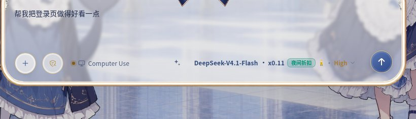

# 提示词优化

在 DSH Web UI 输入框的工具行里加一个**优化**控件：把当前草稿就地改写为结构化提示词，回填输入框，并且可以一键还原原文。

## 做什么，不做什么

- 改写是**纯文本操作**：不执行工具、不发消息、不产生会话轮次。
- 复用**当前会话自己的模型路由**（`agent.model.current()` → Agent options → 部署默认值），不需要额外配置 API Key 或供应商账号。
- 只动**草稿**。附件与 `@` 引用芯片保持原样；草稿以一个已声明的斜杠命令开头时控件不生效，因为覆盖首芯片会丢掉命令声明。

## 样子

输入框工具行里，控件排在模型选择器左侧：

| 草稿已填、待优化 | 优化进行中（再点即取消） | 改写完成（点一下还原） |
|---|---|---|
|  |  |  |

插件页里的条目（标题、描述与图标都来自包内资源，未激活时也能读到）：


## 安装

已发布到 npm，直接装包即可，依赖会一起装好：

```text
plugin_manager install_bundle @qjysqjy/dsh-prompt-optimizer
```

也可以在 **侧边栏 → 插件 → 添加插件** 里输入同一个包名。

想跟 `main` 上的最新提交，从 GitHub 装：

```text
plugin_manager install_bundle github:adonis797/dsh-qjysqjy#path:/packages/prompt-optimizer
```

要改代码就从本地克隆装：先在仓库根 `pnpm install`，再 `install_bundle <仓库根>/packages/prompt-optimizer`。本地路径只做链接、不装依赖，缺仓库根的 `node_modules` 会报 `ERR_MODULE_NOT_FOUND`。

安装后刷新页面即可看到控件。本地安装时改动 `lib/client.js` 后刷新页面生效；改动 `lib/index.js` 需要重新应用插件行（Host 模块已在进程里）。

## 配置

每个字段都可选，缺省走内置默认值。在 profile 的 `cordis.patch.yml` 里按行 id 覆盖：

```yaml
- id: qjysqjy-prompt-optimizer
  config:
    useContext: true
    systemTemplate: |
      You rewrite drafts into terse, concrete task prompts.
      Reply in the draft's own language and return only the prompt.
```

| 字段 | 默认 | 含义 |
|---|---|---|
| `systemTemplate` | 内置 | 系统提示词。空字符串表示用内置契约。 |
| `userTemplate` | 内置 | 首次改写的用户提示词，占位符 `{draft}`。 |
| `revisionTemplate` | 内置 | 增量修订的用户提示词，占位符 `{draft}`、`{previous}`。 |
| `contextTemplate` | 内置 | 携带上下文时追加的段落，占位符 `{context}`。 |
| `useContext` | `false` | 是否把会话近期消息作为背景发给模型。 |
| `maxContextChars` | `2000` | 开启上下文时保留的字符数上限。 |
| `maxDraftChars` | `12000` | 接受的最大草稿长度，超过直接拒绝且不调模型。 |
| `maxOutputTokens` | `4096` | 单次改写的输出上限。 |
| `provider` / `model` | 未设 | 可选的固定路由，两者同时设置才生效，用于停止跟随会话。 |

## HTTP 端点

```text
POST /__qjysqjy-prompt-optimizer/optimize
请求：{ text: string, sessionId: string, previousResult?: string }
响应：{ enhanced: string, language: string, provider: string, model: string }
```

- 空草稿、纯空白、超长、缺 `sessionId` 一律 4xx，**不调用模型**。
- `content-type` 必须是 JSON；带 `Origin` 时校验同源；请求体上限 96 KiB。
- 没有可用路由时返回 409，模型调用失败返回 502。

## 行为契约

| 状态 | 触发 | 控件 | 点击后 |
|---|---|---|---|
| idle | 首次渲染、还原之后 | ✨ | 发起优化 |
| optimizing | ✨ 被按下 | 转圈 | **取消**——`fetch` 被 abort，Host 侧连带中断模型调用 |
| done | 改写已回填 | ↩️ | 还原为捕获的原文 |
| dirty | 回填后用户又编辑 | ↩️ 禁用，并出现第二个 ✨ | 还原被拒绝；第二个 ✨ 基于当前编辑做增量修订 |

测试钉住的规则：

- 空草稿或纯空白禁用控件，不发请求。
- 用户在请求期间继续输入，回填前比对快照，结果**被丢弃**而不是覆盖。
- 还原绝不覆盖改写之后用户自己写的字。
- 缺少 `inputActions.setDraft` 时显式报错，不降级到 DOM 操作。
- 模型输出在 Host 侧确定性清洗（代码围栏、`Enhanced prompt:` / `优化后的提示词：` 标签、外层引号）之后才可能进入草稿。
- 语言锁定：中文进中文出，英文进英文出。

## 布局

```text
lib/index.js     Host 半：路由、路由解析、模型调用
lib/optimize.js  引擎：流收集、失败映射
lib/prompt.js    纯函数：模板、清洗、语言判定
lib/client.js    Client 半：槽位注册、状态机、样式
test/            unit.test.js（纯函数与引擎）、client.test.mjs（状态机）
```

## 测试

```text
node --test test/unit.test.js test/client.test.mjs
```

Client 套件加载**真实的** `lib/client.js`，用最小 React 替身驱动，因此测的是发布出去的那份代码。

## 已实测（DSH 0.2.2-rc.1，Web UI）

用 CDP 驱动真实页面逐条走过：

| 场景 | 结果 |
|---|---|
| 空草稿 | 按钮 `disabled`，`title` 为“草稿为空，无需优化”，无 network 请求 |
| 正常改写 | 200 回填，按钮变↩️，`data-done` 置位 |
| 请求中取消 | `fetch` 收到 `AbortError`，`signal.aborted === true`，草稿不变，提示“已取消优化” |
| 请求中继续输入 | 请求照常返回 200，结果被丢弃，页面提示“草稿在优化期间被修改，结果已丢弃”，用户新写的字保留 |
| 改写后再编辑 | ↩️ 置 `disabled` 且 `data-stale`，强行触发点击也不覆盖；旁边出现增量优化 ✨ |
| 还原 | 草稿精确回到原文，按钮回 idle |
| 中文进 / 英文进 | `language` 分别为 `zh` / `en`，输出语言一致 |

## 已知限制

- 只在 **DSH Web UI** 形态可用（`dsh.client.platform: "web"`）。CLI/TUI 与 ACP 形态不注入任何槽位，未做任何验证。
- `conversation.composer` 是可被接管的 chain；若被其他插件临时接管，本控件随整条工具行一起不渲染。该形态未构造验证。
- 移动端窄视口未在真机验证：控件尺寸按桌面工具行设计（28×28），触摸命中区域未测。
- 深浅色主题只在实际使用的那套皮肤下截图确认过；控件只用 `--dsw-alias-*` 令牌，换肤应当跟随，但未逐皮肤验证。
